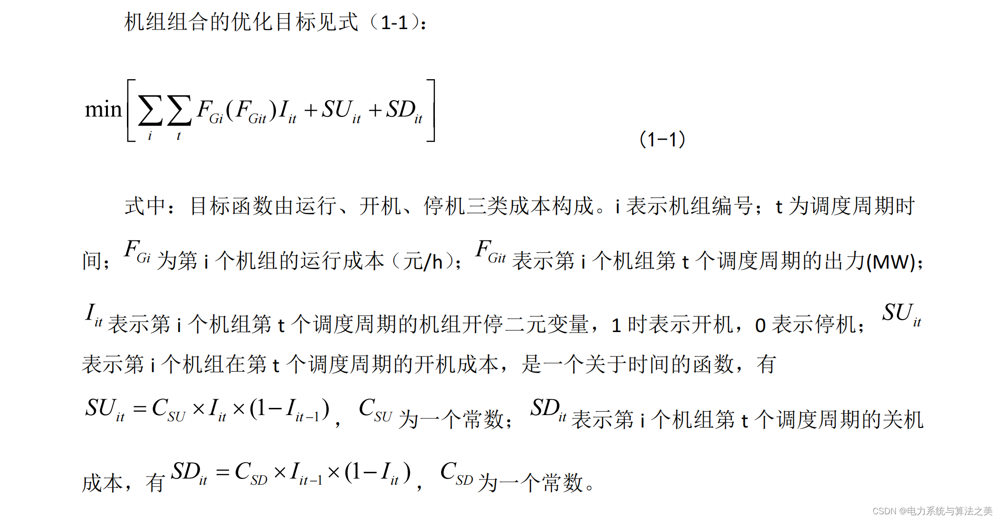
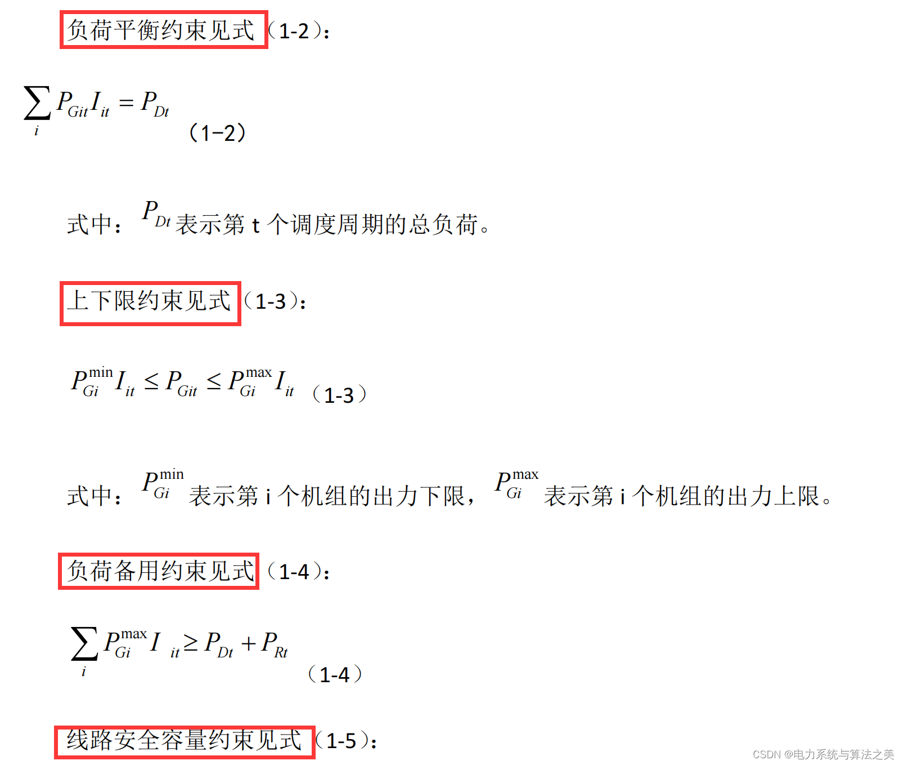
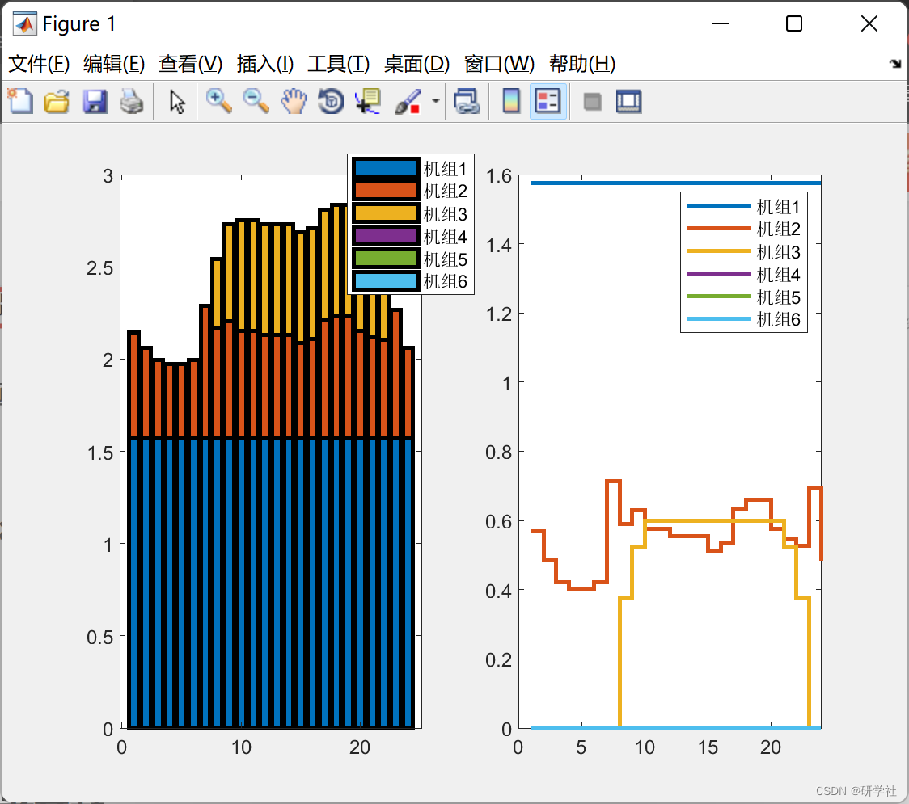

# Mixed Integer Programming for Unit Scheduling (Matlab Code Implementation)

1. The unit combination problem is a NP-hard type of problem, characterized by high dimensionality, non-convexity, discreteness, and nonlinearity. To date, there has not been a good solution. Currently, the algorithms for solving unit combinations mainly fall into two categories: traditional algorithms, including optimization level table method, mixed integer programming, dynamic programming method, Lagrange algorithm, etc.
📚2 Mathematical Model 2.1 Objective Function Edit
2.2 Constraint Conditions Edit
The objective function and constraints in this paper are relatively simple, considering only three units, primarily to facilitate beginner learning.
📚3 Running Results Edit
🎉4 References
🌈4 MATLAB Code Implementation

## Images

<!-- PAYMENT_BLOCK -->

## Get this dataset

- Payment link (Stripe): [Buy now](https://buy.stripe.com/3cs8yP7sY87d0vu9AB)
- Payment QR code: 

<!-- /PAYMENT_BLOCK -->
